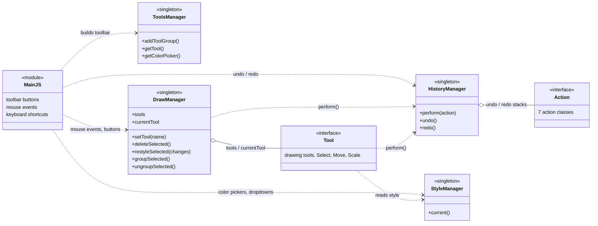
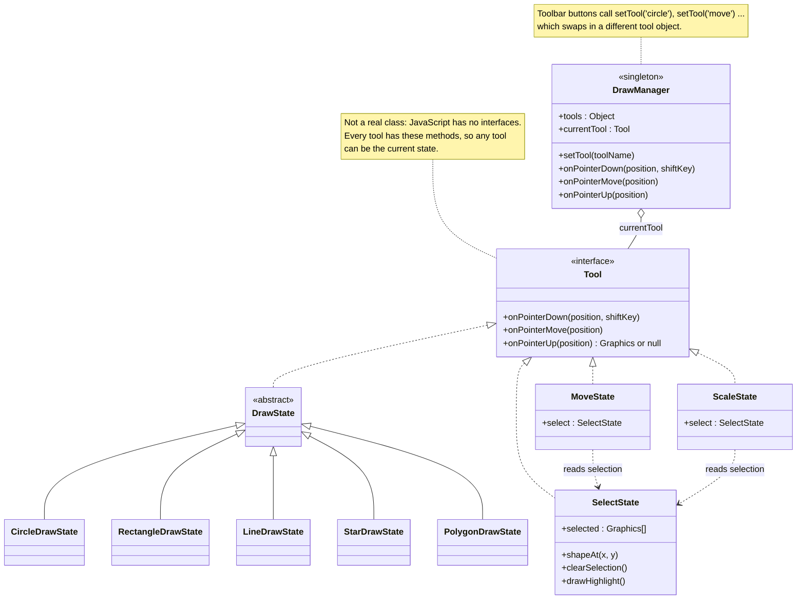
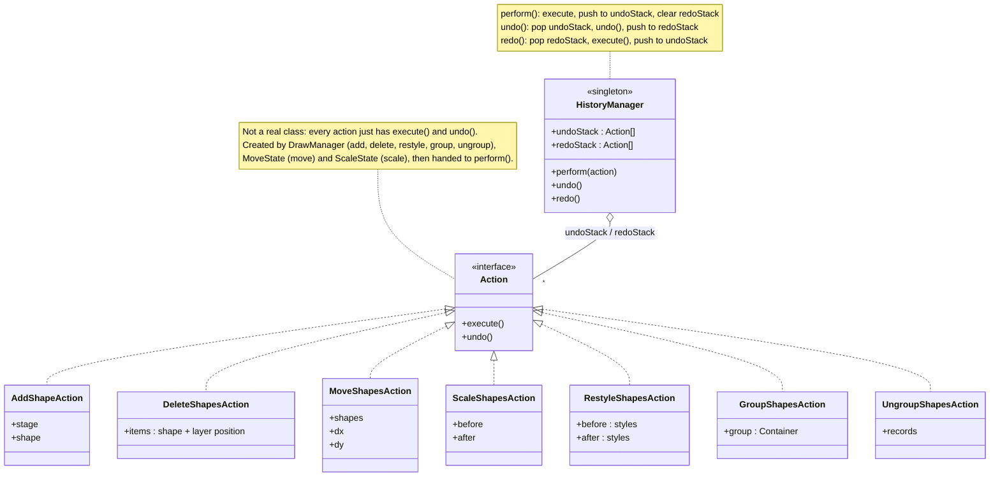
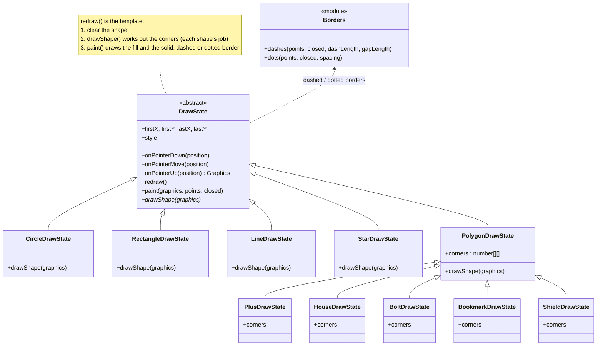
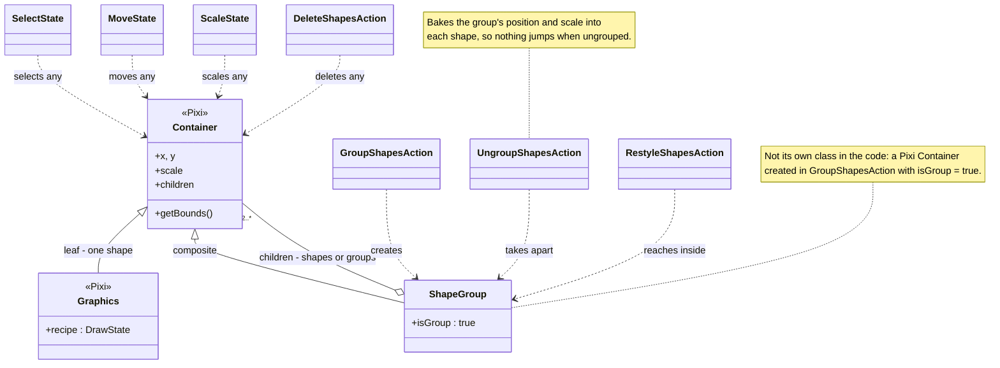
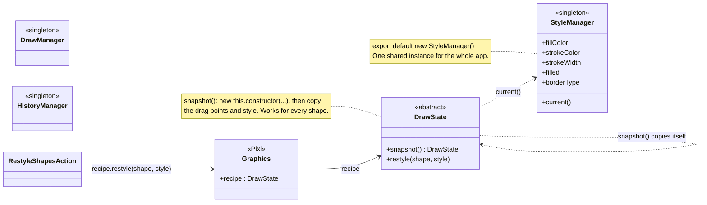
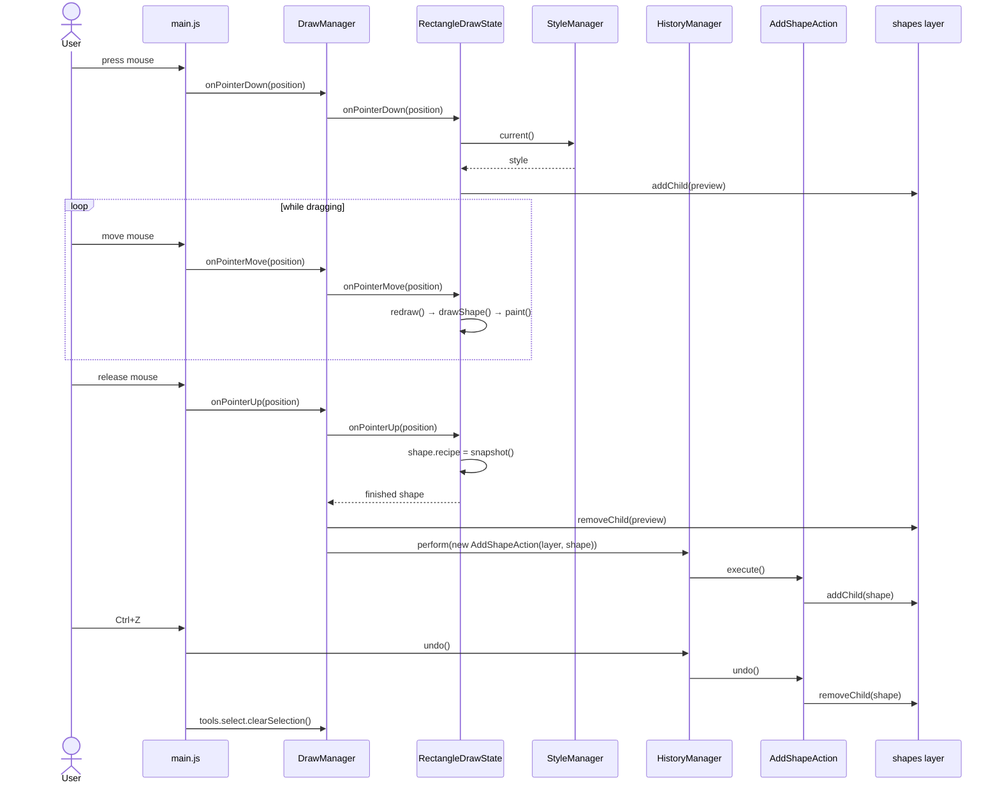

# Painting App: UML Diagrams

How the app is put together, and the design patterns it uses.

| Notation | Meaning |
|---|---|
| Solid line, hollow triangle | Inheritance (`extends`) |
| Dashed line, hollow triangle | Implements an interface |
| Hollow diamond | Holds / keeps a list of |
| Dashed arrow | Uses / creates |
| Underlined member | Static |
| *Italic* method | Abstract (each child class must provide it) |
| Yellow box | Note |

---

## 1. Architecture Overview

The big picture: `main.js` builds the toolbar and sends mouse events to `DrawManager`, which passes them to the active tool. Every change to the drawing goes through `HistoryManager` as an action, so it can be undone.

---

## 2. State Pattern

**What it does:** the canvas behaves differently depending on the active tool (draw a shape, select, move, scale), with no `if`/`else` on the tool type. `DrawManager` forwards every mouse event to `currentTool`, and each tool class handles it its own way. Switching tools just swaps which object is in `currentTool`.

**Files:** `managers/DrawManager.js`, everything in `states/`

---

## 3. Command Pattern (Undo / Redo)

**What it does:** every change to the drawing is an action object with `execute()` (do it) and `undo()` (reverse it). `HistoryManager` keeps two stacks: `perform()` runs an action and pushes it onto the undo stack; `undo()` reverses the top action and moves it to the redo stack; `redo()` does the opposite. Each new feature only needed its own action class to become undoable.

**Files:** everything in `actions/`, `managers/HistoryManager.js`, `managers/DrawManager.js`, `states/MoveState.js`, `states/ScaleState.js`

---

## 4. Template Method Pattern (Drawing Shapes)

**What it does:** `DrawState` handles everything shapes have in common: the click-and-drag, the live preview, throwing away accidental clicks, and drawing the fill and border (`paint()`). Each shape only fills in one step, `drawShape()`, which works out its corner points. `PolygonDrawState` goes one level further: it does `drawShape()` once for all five custom shapes, which only list their corners.

**Files:** everything ending in `DrawState.js` in `states/`, plus `states/Borders.js`

---

## 5. Composite Pattern (Grouping)

**What it does:** a group is a Pixi `Container` that holds shapes, or other groups. To the rest of the app, a group looks like one object, so Select, Move, Scale and Delete work on groups with no extra code. Restyling reaches inside groups (even nested ones) to recolor every shape.

**Files:** `actions/GroupShapesAction.js`, `actions/UngroupShapesAction.js`, `actions/RestyleShapesAction.js`

---

## 6. Singleton and Prototype Patterns

**Singleton:** each manager file ends with `export default new ...()`, so the whole app shares one `DrawManager`, one `HistoryManager` and one `StyleManager`.

**Prototype:** when a shape is finished, its tool makes a copy of *itself* (`snapshot()`), frozen at that exact drag and style, and stores it on the shape as its `recipe`. Restyling later asks the recipe to redraw the shape in a new style. `new this.constructor(...)` makes the copy the right type (star, house, ...) without `DrawState` needing to know which shape it is.

**Files:** `managers/DrawManager.js`, `managers/HistoryManager.js`, `managers/StyleManager.js`, `states/DrawState.js`, `actions/RestyleShapesAction.js`

---

## 7. Sequence: Drawing a Shape, Then Undoing It

All the patterns working together, from mouse press to Ctrl+Z.

